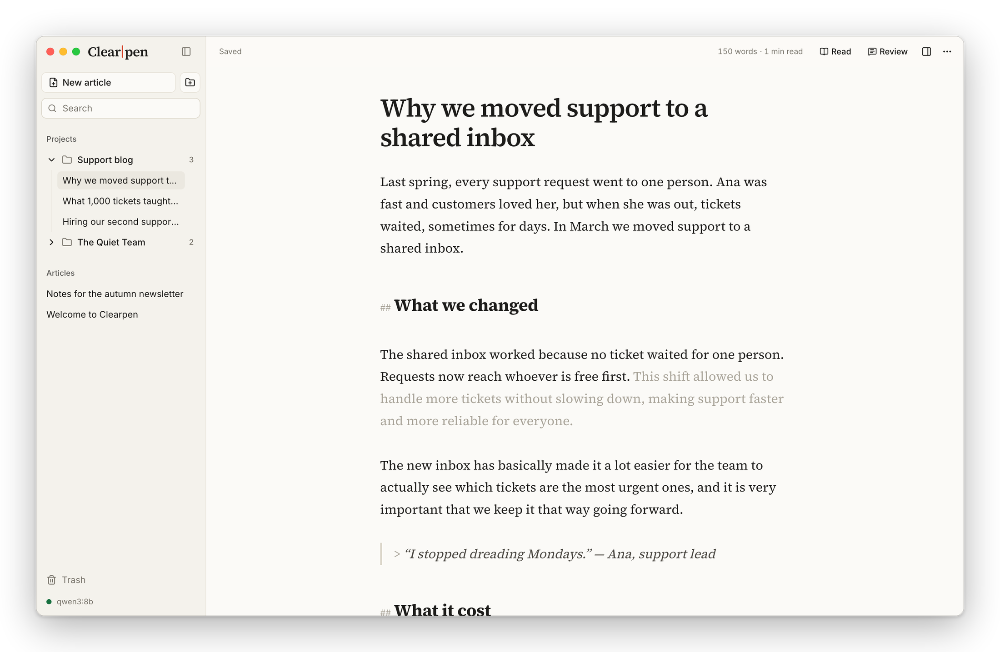
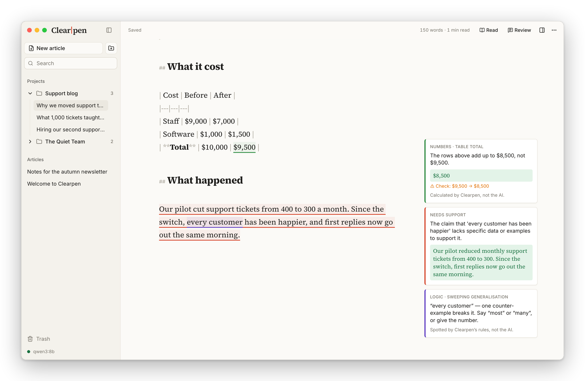

<h1 align="center">Clearpen</h1>

<p align="center">
  <strong>You write. Clearpen edits.</strong><br>
  An open-source writing app for articles that hold up — on your own computer, with AI that runs offline.
</p>

<p align="center">
  <a href="#download">Download</a> ·
  <a href="#run-it-from-source">Run it from source</a> ·
  <a href="docs/ARCHITECTURE.md">Architecture</a> ·
  <a href="LICENSE">AGPL-3.0</a>
</p>

<picture>
  <source media="(prefers-color-scheme: dark)" srcset="docs/screenshots/next-sentence-dark.png">
  
</picture>

Clearpen helps you write articles that hold up. You do the writing; Clearpen edits and helps you think. It marks small edits that you accept or reject, checks your facts, logic and numbers, and tells you what a paragraph is missing. It never writes your article from scratch.

Everything runs on your machine. The AI is a local model through [Ollama](https://ollama.com), your library is a single file, and every article exports to plain Markdown.

> **Status:** early. This repository is being built in phases — see [the architecture](docs/ARCHITECTURE.md). The engine (`packages/core`) is done, and the writing app runs on the desktop: library, editor, versions and export, and the AI features — pinpoint edits, next-sentence suggestions, autocorrect, review and checks, writing modes and guided writing — on a local model. The thinking aids for planning a section, and publishing, come next (see [the plan](docs/plans/writing-app.md)).

## What it does

### One sentence, only when a paragraph needs it

Finish a sentence and pause. Clearpen checks whether the paragraph has made its point, given a reason and said why it matters. If something is missing, the one sentence that supplies it appears in grey, as in the screenshot above: **Tab** keeps it, and typing on ignores it. When a paragraph is complete you see *¶ point made* instead. **⌘J** asks right away, after a sentence or after a lead-in like “Three reasons:”.

### Small, marked changes instead of a rewrite

<picture>
  <source media="(prefers-color-scheme: dark)" srcset="docs/screenshots/pinpoint-edits-dark.png">
  
</picture>

Select a passage and choose **Improve**, **Clarify**, **Shorten**, **Simplify**, **Fix grammar** or a change of tone, or type what you want done, such as “make it punchier”. Only the words that change are marked, each with its own ✓ and ✕. **⌘↵** accepts them all; **Esc** keeps your original.

The edits follow what the research on clear prose agrees on — keep a subject next to its verb, open a sentence on what the reader already knows and end it on the new point, put the action in the verb, plain words, claims as strong as the truth allows — and they keep your voice: your contractions, questions, asides and rhythm, and the one vivid phrase in a paragraph. **Clarify** restructures a passage without shortening it. See [the principles and their sources](docs/research/clear-writing.md).

### A review that shows its working

<picture>
  <source media="(prefers-color-scheme: dark)" srcset="docs/screenshots/review-dark.png">
  
</picture>

**Review** (⌘⇧E) reads the whole draft and leaves notes beside the passages they're about. Clearpen's own checks come first: table totals, percentages, contradictions and sweeping claims, and how the prose reads — a subject far from its verb, a sentence that opens on the new and ends on the known, an action hidden in a noun, a pompous word with a plain twin (one click replaces it), initials never spelled out, a list told in prose, an opening that says what it will discuss rather than what it found — and, in a technical guide or a paper, what the reader who skims needs: a section that never says what it is for, “as discussed above” with nothing to search for, an introduction with no map of what follows, and a line about how hard the problem was. Arithmetic is done by code, never by a model, and every note says whether it came from Clearpen's rules or from the AI. The AI's notes come in order of importance: the argument first, then the structure, then the sentences. On a paragraph that hasn't yet made its point, the review leaves one note saying what is missing and holds the sentence-level notes back under it, to open if you want them. Select a passage and choose **Check** to fact-check it, test its logic, compare it with the rest of the draft, or see how it reads — where a reader links back, waits for the verb and puts the stress.

### Modes, and guided writing

**What this is**, in Insights, sets the article's mode, and the chevron beside **New article** starts one in a mode. A mode is a preset: which of Clearpen's checks run, who the review reads for, and which aids are on. An article, a technical guide, a scientific paper, a business case and an investment note are the kinds of piece Clearpen already read for — a scientific paper is read for a reviewer with a few hours who skips to the main result. Three modes are for writing to think:

- **Clear out ideas** is free writing. Nothing checks or suggests while you write; typo fixes stay. **Review** then reads as a listener, not an editor: the strongest idea on the page, quoted; what you circled without quite saying, as a question; a claim you could test. Never a correction.
- **Reflect** is that, plus three frames, one at a time: *I feel ___ today.* — *That comes from ___.* — *What I want instead is ___.*
- **Work a problem** is that, plus five: what you're working on, why it matters, what you've tried, what stops you, ways forward. A scientific paper offers a skeleton of six: the question, what is known, what is new, the method, the result, what it means.

A frame is a question in the shape of a sentence. It waits in grey at the cursor and on a card beside the page, and you type the whole sentence: the grey text goes the moment you start, Tab inserts nothing, and nothing Clearpen shows ever lands in the article. When your sentence has filled its frame, the next appears, and the coach says on the card what the sentence still leaves unsaid and asks the next question — a question, never words for you to use. **Why this?** explains the frame; **Skip** and **Stop** are yours. Templates are plain data in `packages/core/src/guide.ts`: adding one is adding an entry.

### Insights

**Insights** (click the word count) shows reading level and highlights, the mode, the terms the draft defines, and the **Skeleton**: each sentence by its opening words and its verb, paragraph by paragraph. A paragraph reads as a story about whoever keeps opening its sentences, and a verb shown in grey is “is” or “has”, so the action may be hiding in a noun.

### And a quiet place to write

- A plain Markdown page: headings, lists, quotes, tables and images.
- Projects, full-text search, a trash, and drag-and-drop between projects.
- A version on **⌘S** and every ten minutes, so you can always go back.
- Typo fixes as you type; **⌘Z** right after one puts back what you typed.
- Reader mode, focus mode, light and dark.
- Export to Markdown or a web page, or copy rich text for Google Docs, Medium or WordPress.

On Windows, **Ctrl** stands in for **⌘**.

## Download

Installers for Mac and Windows are on the [Releases page](https://github.com/AQSAKAL/clearpen/releases). They're early builds and not signed yet, so your computer warns you the first time you open Clearpen.

| | Download | The first time |
|---|---|---|
| **Mac** — Apple silicon or Intel, macOS 13.3 or later | `Clearpen_<version>_universal.dmg` | Open it and drag Clearpen to Applications. When macOS says it can't check the app, go to System Settings → Privacy & Security and choose **Open Anyway**. |
| **Windows** — 10 or 11, 64-bit | `Clearpen_<version>_x64-setup.exe`, or the `.msi` | Run it. If SmartScreen says "Windows protected your PC", choose **More info** → **Run anyway**. |

Clearpen's AI runs on your computer, through [Ollama](https://ollama.com), which is free. The first time you open Clearpen, it checks for Ollama and links you to it if it's missing. Then it downloads a writing model for you, with its progress:

- **Qwen3 8B** (5.2 GB), for computers with 16 GB of memory or more;
- **Qwen3 4B** (2.5 GB), lighter and quicker, for 8 GB.

You can write without the AI: choose **Not now**, and set it up later from the sidebar. Your writing stays on your computer.

### The first run

Once the model is set up, Clearpen asks what you will write — an article, a technical guide, a scientific paper, a reflection or journal, a business case or an investment note — and opens a short example of that kind. The example is yours to edit: its blanks are in [brackets], and the lines marked ✎ are a tour, each beside a passage planted for Clearpen to catch — a table whose total is wrong, a sweeping claim, initials never spelled out, an abstract that never states the result — saying what to press. Your answer also sets what new articles start as; change any one article under Insights → **What this is**, and open another example any time from ⋯ → **Start from an example…**.

## Run it from source

You need:

- [Node](https://nodejs.org) 24 or later and [pnpm](https://pnpm.io/installation) 11;
- [Rust](https://rustup.rs) 1.90 or later, plus the Xcode Command Line Tools on Mac (`xcode-select --install`), or the [Microsoft C++ Build Tools and WebView2](https://tauri.app/start/prerequisites/) on Windows;
- [Ollama](https://ollama.com), for the AI features.

Then:

```bash
git clone https://github.com/AQSAKAL/clearpen.git
cd clearpen
pnpm install
pnpm --filter @clearpen/desktop tauri dev
```

The first run compiles the Rust side of the app and takes a few minutes; after that, the window opens in seconds and reloads as you edit. On first launch Clearpen offers to download a model through Ollama. To get one yourself:

```bash
ollama pull qwen3:8b             # 16 GB of memory or more
ollama pull qwen3:4b-instruct    # 8 GB
```

Your library lives in one SQLite file, `library.db`, in `~/Library/Application Support/app.clearpen.desktop/` on Mac or `%APPDATA%\app.clearpen.desktop\` on Windows.

### Or try it in a browser, without Rust

```bash
pnpm --filter @clearpen/desktop dev
```

Open http://localhost:1420. The app runs on the same library code, with SQLite compiled to WebAssembly and held in memory, so **nothing is saved** when you close the tab. It talks to Ollama on `localhost` directly.

### Build an installer

```bash
pnpm --filter @clearpen/desktop tauri build
```

Installers land in `apps/desktop/src-tauri/target/release/bundle/`. Signing, releases and the universal Mac build are in [apps/desktop/README.md](apps/desktop/README.md).

## Develop

```bash
pnpm check        # lint, typecheck and test everything
pnpm test:watch   # tests while you work
```

The tests run the real AI tasks against a scripted model, so they need neither Ollama nor a network. Before a bigger change, read [the architecture](docs/ARCHITECTURE.md) and [CONTRIBUTING.md](CONTRIBUTING.md).

```
packages/
  core/       the engine — checks, diffs, prompts, the LLM client and AI tasks
  db/         the library — schema, migrations and repositories (SQLite; Postgres with the server)
  editor/     the CodeMirror editor — Markdown, ghost text, tracked suggestions, notes, images
  ui/         the app in React and shadcn/ui, behind a Backend interface
apps/
  desktop/    Tauri app for Mac and Windows
  server/     self-hosted server with Postgres         (phase 4)
  web/        the app in a browser                     (phase 4)
docs/
  ARCHITECTURE.md
```

## Principles

1. **You write; Clearpen edits and helps you think.** The AI never writes your article from scratch — no drafted sections, paragraphs, openings or conclusions. It edits what you wrote, outlines logic and argument, and checks facts and reasoning. The one exception is the next logical sentence: when you finish a sentence and pause, Clearpen first checks whether your paragraph has made its point. Only if something is missing does it suggest the one sentence that supplies it — in grey, used only if you accept it, and never twice in a row.
2. **Your words are yours.** Local by default; nothing leaves your machine unless you configure it to; everything exports to plain Markdown.
3. **Never lose a word.** Durable storage, versions, a trash, backups.
4. **AI proposes; you decide.** Pinpoint edits you accept one by one. Checks that say where their knowledge came from. Arithmetic done by code, never by a model.
5. **Write each feature once.** One engine runs on the desktop, the server and the cloud.

## License

AGPL-3.0-or-later — see [LICENSE](LICENSE). Contributions are accepted under a contributor licence agreement; see [CONTRIBUTING.md](CONTRIBUTING.md).
